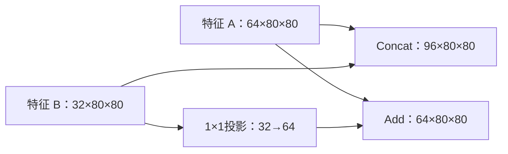

# 模型参数、自由模块连接与网络自动适配：可实施方案（修订2）

日期：2026-10-23。性质：实施设计，尚未把本方案中的新编辑、拓扑和适配功能加入产品。

修订2依据用户补充：可以自由添加模块，并通过Concat（cat，通道拼接）或Add（逐元素相加）连接分支。本文保留填充/步幅方案，补齐图编辑、图编译、通道重建和检测头扩展；第12节是新的统一开发顺序，第15～23节为拓扑细则。第5节schema2已更新为统一图格式，取代修订1尚未实现的“edits+独立adapters”字段提议，不是要同时维护两套模型。

## 1. 要实现的行为

用户可以独立编辑卷积核大小、填充 padding、步幅 stride；还可以从模块库添加/复制/删除模块，插入分支、改连线，并明确选择Concat或Add融合。自由连接限于受支持模块与合法有向无环图，不能把任何两根线不加检查地合并。修改后自动显示真实输入输出，定位下游冲突，给出明确的适配建议；用户预览并一键应用后，重新检查前向、检测步长、损失、梯度和模型保存。

默认流程选用“自动检测 → 推荐方案 → 预览 → 一键应用”。这是本方案的建议默认值，尚不是用户已确认的产品偏好。自动检测不等于未经展示就插入缩放、裁剪或修改其他层。

例如输入640，第0层原为kernel=3、padding=1、stride=2；用户改为kernel=7、padding=1时，实际输出应为318，不能再偷偷把padding改成3保持320。

## 2. 当前代码能复用什么，还缺什么

| 位置 | 当前能力 | 本轮需增加 |
|---|---|---|
| model_design/core.py | 官方版本核对、构建、白名单编辑、模块与算子实测 | 统一设计入口、稳定ID、图导入/编译、几何与通道检查、检测步长重算 |
| model_design/worker.py | 独立进程前向/损失/反向、修订和源码快照 | 冲突报告、候选计划、分阶段检查、适配操作实测 |
| model_design/training.py | 加载设计、训练前重建并回放修改 | 回放适配器及新的检测步长，核对完整结构身份 |
| desktop/model-designer.js | 自动实测、撤销、恢复、历史 | 参数模式切换、修复预览、事务式应用、过期候选失效 |
| desktop/model-graph.js | 顶层真实连接、非法连接拦截 | 可编辑端口/边、Concat/Add、显式适配节点、稳定ID与当前层号映射 |
| views/workflow/desktop_controller.py | 训练前验证并冻结配置、源码、数据 | 核对适配计划、尺寸域与运行时依赖，冻结新证据 |

当前“同一个算子只能有一条编辑记录”和“修改核自动配padding”的实现必须调整，不能只往页面加两个输入框。

## 3. 首版支持范围

### 3.1 编辑参数

| 字段 | 首版输入范围 | 默认/约束 |
|---|---|---|
| kernel | 1、3、5、7，及该层原始核用于恢复 | 高宽相同；原始6×6等必须能正确展示/恢复 |
| padding | 0～16整数 | 首版四边对称、补零；明确指特征图位置数量 |
| stride | 1或2 | 首版高宽相同，禁止0、负数、非整数 |
| dilation、groups、通道 | 几何编辑阶段只读 | 拓扑阶段开放受支持模块的输出通道，输入通道由连线推导，详见第17节 |
| 输入尺寸 | 现有64～1280 | 还必须满足修改后检测步长的更严格约束 |

提供两种padding模式：

- **保持原输出尺寸**：兼容现有核大小编辑策略。修改核时推导padding，不能实现时明确报错；改变stride时不承诺能保持原尺寸。
- **手动设置**：kernel、padding、stride彼此独立，严格使用用户输入，绝不回写隐藏的自动填充值。

保持/手动选择作为节点geometry_policy显式保存，推导出的有效padding与params一起记录。字段同时显示“模板值、当前值、预计尺寸、实测尺寸”。选择手动模式时，以一句话提示“核大小改变后输出可能变化，下游连接将重新检查”。

### 3.2 分层开放

1. 第一批：YOLOv8n/s、YOLO11n的顶层Conv模块，具体路径如model.0.conv、model.5.conv。
2. 原有内部卷积核/激活编辑继续保留；内部Bottleneck、C2f、注意力模块里的padding/stride先只读，检测到内部冲突时明确路径。
3. 第一批通过后，再逐家族、逐规模扩展到当前25个模板。未通过新能力验收的规格仍可用原有功能，不能仅因名字加入目录就宣称支持自动适配。
4. 几何阶段只处理顶层Concat空间适配；拓扑阶段增加用户显式创建的Add和1×1通道投影。现有复合模块内部残差、注意力规则仍单独验收，不因支持顶层Add就宣称内部可自由改写。
5. 自由拓扑先开放YOLOv8n/s的模块级图；YOLO11及其他模板逐项通过导入等价、训练和加载后开放。用户截图中的YOLO26需要双分支头验收，不能拿YOLOv8的通过结果替代。

这样可以先交付有用的功能，而不用先重写全部网络内部计算图。

## 4. 实测探针：关键路径确实可行

本次在当前YOLOv8n运行时做了独立临时探针，脚本和JSON保存在同名方案证据目录；没有修改第三方安装包或产品构建规则。

### 4.1 手动padding确实改变尺寸

输入[1,3,640,640]，第0层改为kernel=7、padding=1、stride=2：真实输出[1,16,318,318]。

依据PyTorch卷积定义，单轴输出为：

`floor((输入 + 2×padding - dilation×(kernel-1) - 1) / stride + 1)`。

它只用于支持范围内的预测，最终仍以实际前向为准。[PyTorch Conv2d说明](https://docs.pytorch.org/docs/2.10/generated/torch.nn.Conv2d.html)

### 4.2 步幅变化产生可定位的冲突

把model.5.conv的stride从2改成1，128输入下，首次冲突出现在model.14的Concat：

- 第0路：32×32；
- 第1路：来自model.4，16×16；
- 原生拼接无法直接执行。

临时探针显式采用“参考第0路，对第1路nearest插值”的策略后，网络可以前向。这个策略是探针指定的，没有证明它一定是最佳修复。

### 4.3 前向通过仍可能带着错误的检测步长

同一个适配模型在128、256、640三个输入下，三路检测特征的实际倍率均为4/8/16；模型对象原先记录的head.stride却仍是8/16/32。

这是本轮最重要的实现约束：**不能只修好Concat后就允许训练，否则可能使用过期步长生成锚点、计算损失或解码边框。**

改变后是三个检测尺度整体移动，不是自动新增了第四个小目标检测头。方案和界面必须区别这两件事。

## 5. 数据结构：把修改、建议、实际应用分开

### 5.1 schema=2统一图：唯一结构来源

schema2目前尚未实现，因此直接采用节点、端口、有序边的统一格式，不先发布只能保存参数的schema2，再立即重做迁移。顶层结构以graph为准；布局与未应用候选另外保存。以下是局部格式示例，不包含完整检测网络，不能直接用于训练：

```json
{
  "schema": 2,
  "task": "detect",
  "template": "yolov8n",
  "source": {"reference": "由工具生成的官方与工作台源码身份"},
  "nc": 1,
  "imgsz": 128,
  "seed": 42,
  "input_policy": {"kind": "fixed_square", "checked_sizes": [128,256]},
  "graph": {
    "nodes": [
      {"id":"input_rgb", "op":"Input", "op_version":1,
       "params":{"channels":3}},
      {"id":"n_a", "op":"Conv", "op_version":1,
       "params":{"out_channels":64,"kernel":3,"stride":1,"padding":1,"activation":"SiLU"},
       "origin":{"module_path":"model.4","source_ref":"官方实现快照"}},
      {"id":"n_b", "op":"Conv", "op_version":1,
       "params":{"out_channels":32,"kernel":1,"stride":1,"padding":0,"activation":"SiLU"},
       "origin":{"kind":"user_added","factory_ref":"conv_v1"}},
      {"id":"n_cat", "op":"Concat", "op_version":1,
       "params":{"dim":1}, "input_ports":["in_a","in_b"]}
    ],
    "edges": [
      {"id":"e1","from":["input_rgb","out"],"to":["n_a","in"]},
      {"id":"e2","from":["n_a","out"],"to":["n_b","in"]},
      {"id":"e3","from":["n_a","out"],"to":["n_cat","in_a"]},
      {"id":"e4","from":["n_b","out"],"to":["n_cat","in_b"]}
    ]
  }
}
```

source等占位内容在实际保存时必须换成校验过的身份；完整图还必须声明唯一Input与唯一终端Detect。端口ID稳定，`input_ports`数组保存次序，删一个端口不把其他端口的身份重新编号。

- 稳定节点ID不等于model.15等当前执行层号。原模板路径保存在origin，编译后生成node_id→当前运行路径映射。
- 普通参数进入节点params；受支持内部参数覆盖使用该节点下的相对成员路径，如`member_overrides`中的`cv1.conv`，禁止再用不稳定的model.15作为修改定位依据。
- 已应用的ResizeLike、PadLike、CropLike、ChannelProject都是graph中的实际节点；未应用候选不进入graph。参考张量也必须有边，参与回环检查。
- 同一个节点的多字段、增删节点和连线修改一次规范化/编译，以整份事务撤销。
- 节点按稳定ID排序序列化；边按目标节点/端口ID排序，但Concat、Add、Detect的端口次序必须额外保留，不能通过排序抹掉输入顺序。
- 结构哈希包括有序连接、有效参数、内部覆盖、算子版本和头契约；检查身份另包含输入、seed、源码与环境。画布坐标另存layout.json，不影响结构哈希。
- schema1先以旧规则核对历史原始哈希，再导入内存图；参数路径转换成稳定节点ID+相对成员路径；迁移前后须实测等价，再存新修订。旧修订不覆盖，迁移失败仍允许查看历史和明确说明原因。

### 5.2 冲突报告

每次检测返回：设计哈希、任务generation、冲突ID、节点/端口、实际输入尺寸、错误类型、上游修改路径及可用候选。

错误类型至少包括：`invalid_conv_output`、`concat_spatial_mismatch`、`residual_shape_mismatch`、`attention_shape_constraint`、`invalid_detection_stride`、`resource_limit`、`unsupported_internal_op`、`cycle_detected`、`missing_input`、`invalid_port_type`、`add_shape_mismatch`、`orphan_node`。

无法可靠定位到内部函数式Add/Concat时，显示最后可确认的模块边界和真实异常，不编造内部连线。

### 5.3 候选计划

候选附带`based_on_design_hash`、目标尺寸来源、将插入的操作、改变的元素/范围、插值算法、检测尺度变化、所需确认项和源代码位置。用户再改参数、尺寸、模板或端口后，候选立即失效，必须重新计算。

## 6. 检测与修复算法

### 6.1 检测流水线

1. 合并编辑事务，检查范围、类型与目标路径能力。
2. 用卷积公式快速判断输出是否为正，预估明显的空间尺寸膨胀。
3. 在独立进程构建草稿，注册支持节点的pre-hook和必要模块适配器。
4. Concat/Add执行前记录所有输入的N/C/H/W；若各自要求的维度不一致，返回结构化冲突，不让PyTorch长异常替代用户说明。
5. 记录各条分支的实际来源和影响路径。首次冲突后其下游标记为“尚未测得”，不能显示上次尺寸；未受影响的并行分支可继续单独测量，不将其冒充完整网络已通过。
6. 在隔离副本上模拟候选，重新检测；修复后可能暴露后续冲突，继续迭代直到通过或达到预算。
7. 有效候选进入预览；应用后重新跑正式检查，不把候选模拟结果直接当成训练凭证。

### 6.2 每个Concat明确参考输入

默认提供“以第0输入为参考”的候选，也允许用户选择其他输入。第0输入是稳定默认策略，不代表天然语义正确或精度最高。

参考路不改动；其余每一路以单独适配节点对齐到参考路。多输入Concat不能只支持两路。

### 6.3 修复方式

| 方式 | 首版行为 | 使用条件/影响 |
|---|---|---|
| 补齐 | 只在右侧/下侧补零到参考尺寸 | 只能扩张；保留已有位置和数值，新增位置仍是人工值 |
| 裁剪 | 只裁右侧/下侧到参考尺寸 | 只能缩小；明确显示丢弃数量，需用户选择 |
| nearest插值 | 精确指定参考高宽 | 常见整数倍变换的优先候选；重复/丢弃采样信息 |
| bilinear插值 | align_corners=False，明确记录 | 用户显式选择；混合邻近值，不能称作无损 |
| 混合高宽方向 | 如一轴需补另一轴需裁 | 首版不自动组合，要求选择插值或重新调整参数 |

首次建议规则：

- 两路已同尺寸：不插入适配器。
- 每轴差值至多1：展示右/下补齐或裁剪候选，列出差值；不默认丢掉边缘。
- 高宽同时为精确2倍/半倍：展示nearest候选，明确改变哪一路。
- 其他差值：可以人工选择插值预览，标为较大几何变更，首版不自动推荐为低风险。
- 超过4倍空间倍率、dtype/批量不符或参考输入本身不合法：首版拦截。Concat允许各路通道不同，输出C为各路之和；下游输入通道须重新推导/重建。Add的通道约束与显式投影见第17节，不能把两者混为一谈。

候选优先级：满足合法约束 → 无裁剪 → 更少适配操作 → 更小空间变化。排序规则公开，不称为智能最优架构搜索。

### 6.4 尺寸相同不保证空间含义相同

stride和padding都可能改变采样间隔或起始位置。首版记录变更前后参数、名义采样倍率和可计算的起点偏移；对普通卷积链可递推间隔与感受野，对插值、注意力及函数式分支不能可靠推断时标记“几何对应未证明”。

不能仅凭79×79和80×80就断言补1像素一定对齐；“无需重采样”的低风险标记还要求已知分支来源与网格关系支持。未知时仍可由用户明确选择候选做实验，但结果标为几何有变更，不能宣称无损或保证精度。

裁剪/补齐锚定方式首版固定在右/下，避免默默居中移动左上起点；需要改变锚定方式时生成不同候选及独立证据。

## 7. 检测头处理：训练前必须完成

构建顺序：官方模板 → 参数编辑 → 已应用适配器 → 重新测量检测特征 → 更新检测步长与缓存 → 前向/损失/反向 → 保存。

1. 在所选输入和参考输入256上，以eval方式运行至Detect入口，捕获特征后中断，不先用旧stride做解码；若所选就是256，再用128等不同尺寸验证。
2. 对每路特征计算高、宽对应倍率。首版要求二者相同、为正整数的2次幂、各尺度严格递增，且两种输入得到相同步长；拒绝重复/乱序/尺寸相关的分数倍率。
3. 几何阶段开放范围：[4,8,16]、[8,16,32]、[16,32,64]；四尺度阶段单独增加[4,8,16,32]。超出已验收范围进入后续适配，不自动包装成当前已支持结构。
4. 所选训练尺寸须满足新最大步长的整除要求和最小尺寸要求，至少为2×最大步长；例如新最大步长64时，96不能继续训练，应选择128等合法尺寸。
5. 同步更新Detect.stride和DetectionModel.stride，清空该版本的shape/anchors/strides等推理缓存，新建训练模型的头部偏置初始化采用新步长；加载已有权重时禁止重新初始化偏置，首版不支持对既有训练检查点直接改结构后断点续训。所有结构修改和步长校准发生在优化器创建前，已有权重文件不覆盖。
6. YOLO26同时检查一对多和一对一分支、reg_max=1/Identity的原有结构；其他模板保持各自官方头部配置。
7. 检查anchor生成使用新stride、box解码及loss使用同一组新stride；新旧进程都验证，不仅比较参数量。
8. 训练入口核对冻结尺寸，阻止训练器静默把输入从96舍入到128；多尺度/rect/多卡仍沿用当前禁用范围。

该顺序依据当前固定官方版本DetectionModel构造阶段会用256输入推导步长的实际实现；本工具是构建后修改，因此必须显式重算。[固定官方tasks.py](https://github.com/ultralytics/ultralytics/blob/2849d4f03f63e114382026bab3f68cf52d9c9a1e/ultralytics/nn/tasks.py)

## 8. 编译实现与模型保存

### 8.1 工程实现

沿用独立的geometry.py、adaptation.py、adapters.py职责，并加入图schema、模块注册、导入、编译与来源映射，文件分工见第20节。

所有用户模块、融合和适配统一编译成有序执行模块；保留固定版本原生DetectionModel的预测/损失接口。为自由连接加入显式Input节点，编译器统一重算每层f/i和save，不在图层号发生变化后继续沿用旧数值。详细构建策略、模块工厂与验收边界见第18节。

修订1曾建议把适配隐藏封装在AdaptiveConcat内部；本次统一改为图中的显式适配节点，参考路也是实际输入依赖。这样能处理Add、改端口和自由重连，避免界面与运行模型成为两张不同的图。已有官方Concat无需替换，新的Add等由本仓库具名类实现，不修改site-packages。

适配器根据运行时参考张量获取目标H/W，不能硬编码检查输入128时的16×16。每次记录适配前后尺寸及算法。

### 8.2 图与实际运行必须对应

在对应边上显示小型“缩放/补齐/裁剪”节点，点击可查看实际运行路径，如model.17（由稳定适配节点ID映射得到）。图中须表明其由工作台新增，并非官方模板原有模块。

原始模块from连线作为基线只读保存；当前显示图使用“来源 → 边适配 → Concat输入端口”的有效数据流。需要同时记录Concat适配前输入和拼接前输入，不能把适配前的尺寸作为最终Concat尺寸。

结构签名必须包含参数、适配器方法/端口/锚定/参考输入和检测头契约；实测步长与输入策略纳入对应检查身份。适配器可能没有训练参数，不能仅靠state_dict或参数总量判断两设计相同。

### 8.3 保存兼容性必须诚实

包含自定义Add/EdgeAlign等模块的PT，需要相同版本工作台运行时；不能继续承诺任意纯Ultralytics环境直接加载。即便外层仍为原生DetectionModel，内部自定义类也有依赖。

首版交付：PT、schema2配置、源码版本/哈希、依赖清单和工作台加载器；新进程必须完成加载/预测测试。仅使用原生模块的设计可保留原生DetectionModel类型，但图描述仍须由工作台加载器正确回放，不能据此省略图校验。ONNX导出另做数值一致性验证，未验证的导出格式明确标为未开放。

## 9. 界面与交互

- 右侧编辑区同屏显示kernel、padding、stride和模式；术语旁保留帮助弹窗。
- 输入参数防抖约650毫秒后自动检测；“自动应用参数”和“自动插入修复”分成不同开关，前者不能授权后者。
- 无冲突：展示新旧实际尺寸、检测尺度和变化路径。
- 有冲突：画布标红问题节点/端口，右侧展示冲突卡；下游显示“未测得”，不是旧数值。
- 候选卡显示哪个端口被改、16→32、nearest或裁剪数量、检测尺度8/16/32→4/8/16等结果。
- “预览方案”只在副本模拟；“应用方案”把参数与适配操作作为一个可撤销事务。
- 后续可开放自动修复开关，但仅限用户预先允许的参考路和规则；裁剪默认不在自动允许列表。
- 任务带generation和design_hash，旧结果不覆盖新输入；失败/停止后训练按钮保持禁用。

## 10. 检查、证据与研究用途

保存一个可训练修订必须具备：源配置/实现一致、参数合法、冲突全部解决、选定尺寸与参考尺寸前向通过、检测步长一致、真实合成loss有限、梯度有限、新进程重建和保存加载一致。

记录：原始模板身份、编辑前后参数、原始冲突、候选与应用选择、各端口尺寸、几何状态、头部步长/模式、合成检查、源码/环境/配置/权重/数据哈希。适配器本身也纳入源码快照。

论文实验至少分组：原始模型；改参数但无需适配的有效结构；改参数+已选适配；同参数下不同适配算法。若“只改参数”的结构不可运行，报告不可运行，不能为了凑对照偷偷再插入操作。保持数据划分、输入、训练预算及种子协议一致，报告参数/FLOPs/速度及实际精度；有无插值/裁剪必须公开。

## 11. 关键验收用例

| 用例 | 必须得到的结果 |
|---|---|
| 640输入，k7/p1/s2 | 第0层输出318；当前值保持p1 |
| k7/p3/s2，保持模式 | 输出320，明确记录自动填充 |
| 同一算子同时改k/p/s | 原子应用和撤销，不丢字段 |
| model.5.conv从s2到s1 | 准确定位Concat14端口冲突 |
| 参考端口0的nearest方案 | 图中显示新增节点；128下检测特征32/16/8 |
| 校准检测步长 | 同时使用4/8/16，禁止旧8/16/32继续解码 |
| 参考输入128/256/640 | 目标尺寸来自参考张量，步长保持一致 |
| 非整数/各向异性/重复检测步长 | 明确阻止训练 |
| 内部Bottleneck残差冲突 | 显示准确模块，首版不自动插入内部修复 |
| 三路Concat | 每端口独立核对和记录，不丢一路 |
| 候选生成后再改参数 | 老候选不可应用 |
| 裁剪、补齐 | 边界方向明确，元素损失/新增数量可核对 |
| 应用后再撤销 | 参数和适配器一起恢复 |
| 历史加载、恢复初始化 | 可完整回放；初始化移除派生适配器 |
| 训练前重建 | 编辑、适配器、步长都保留，优化器引用正确 |
| PT新进程加载 | 提供工作台运行时后输出一致；缺依赖有明确说明 |
| 原有25模板不使用新功能 | 原有结构、签名和流程回归通过 |

## 12. 统一开发顺序与交付门槛（替代修订1的M1～M4）

| 阶段 | 交付内容 | 通过才开放 |
|---|---|---|
| G0 图基础 | schema2、稳定ID/端口、模板导入、模块注册、确定性编译、来源映射 | YOLOv8n/s不改图导入后权重和train/eval输出等价；历史参数迁移等价 |
| G1 独立参数 | 多字段编辑、padding/stride、真实尺寸、冲突卡、检测步长校准 | k7/p1/s2实测318；新步长正确；未解决冲突不能训练 |
| G2 自由连接 | 模块库、插层/删除/复制/重连、Concat/Add、通道推导与重建、撤销 | 分支连线/端口次序正确；新增分支梯度可达；下游通道自动匹配；拓扑草稿可存 |
| G3 显式适配与训练闭环 | ResizeLike/补齐/裁剪、1×1投影、预览应用、统一训练/预测/验证加载器、源码冻结 | 改图短训、保存、新进程加载、验证通过后开放正式训练；G2只有前向不能提前冒充完整交付 |
| G4 小目标四尺度 | 新建P2融合分支、重建四输入Detect、四尺度loss/解码 | 4/8/16/32特征、训练、重载和资源检查；对比原三尺度模型 |
| G5 扩展 | YOLO11及25规格逐步开放、内部模块子图、导出 | 每种模块/模板分别通过等价与训练矩阵；YOLO26双分支单独验收 |

各阶段使用同一个图schema与构建入口，避免参数版、连线版、训练版三次重写。G0/G1先交付可检查基础，G2/G3合起来才算“可自由连接并用于实验”的第一版。内部任意拆模块、多尺度和所有导出格式不挤入该首版。

## 13. 可实现性自审

| 自问 | 判断 | 落地手段 |
|---|---|---|
| 只加输入框够不够？ | 不够 | 必须同时改编辑schema和编译顺序 |
| 能否测到真实输出变化？ | 已有局部探针证明 | k7/p1/s2得到318，不自动补回320 |
| Concat冲突能否显式修复？ | 已有单例前向证明 | 固定参考端口、显式插值，记录新增操作 |
| 修好Concat是否就可训练？ | 不能据此判断 | 探针发现旧head.stride未更新；G3必须完成 |
| 能否保证适配无损、精度不降？ | 不能 | 公开几何改变与适配算法，用实验比较 |
| 能否第一版适配所有内部Add和注意力？ | 不应承诺 | 按模块能力开放，未知规则阻断/诊断 |
| 会不会破坏代码溯源？ | 可以保持 | 官方基线不改，工作台适配器独立版本与源码快照 |
| 是否还能完全免依赖加载自定义PT？ | 不能默认保证 | 明确运行时依赖，单独验证导出 |

## 14. 参考资料与本次探针

- [PyTorch 2.10 Conv2d参数、输出定义](https://docs.pytorch.org/docs/2.10/generated/torch.nn.Conv2d.html)
- [PyTorch 2.10 interpolate算法与align_corners](https://docs.pytorch.org/docs/2.10/generated/torch.nn.functional.interpolate.html)
- [固定官方DetectionModel/parse_model实现](https://github.com/ultralytics/ultralytics/blob/2849d4f03f63e114382026bab3f68cf52d9c9a1e/ultralytics/nn/tasks.py)
- [固定官方Concat实现](https://github.com/ultralytics/ultralytics/blob/2849d4f03f63e114382026bab3f68cf52d9c9a1e/ultralytics/nn/modules/conv.py)
- [固定官方Bottleneck、注意力等模块实现](https://github.com/ultralytics/ultralytics/blob/2849d4f03f63e114382026bab3f68cf52d9c9a1e/ultralytics/nn/modules/block.py)

本次探针：相邻`填充步幅与网络自动适配_方案证据_20261023`目录，包含脚本、真实运行JSON与SHA256清单。它验证了核心局部路径和关键风险，不等同于方案已全部实现。

## 15. 本次复审结论：原方案缺了哪些必要条件

| 缺口 | 不补会怎样 | 修订2的处理 |
|---|---|---|
| 修改目标仍是model.N路径 | 插入一层后编辑可能落到别的层 | 稳定节点ID，模板路径与运行路径分开 |
| 只有参数记录，没有实际图 | 无法可靠描述添加、删除、重连 | schema2统一图是唯一结构来源 |
| 只看H/W，不推导C | Concat成功后下个卷积仍可能报通道错误 | C/N/H/W、端口类型及下游构建参数一起检查 |
| 把连线等同于融合 | 多路输入到底cat还是相加不清楚 | 普通边只传递；融合必须有Concat/Add节点 |
| 只改f，没有更新save | 跳连引用可能拿到None | 编译时统一重建f/i/save和来源映射 |
| 原图输入只靠第0层的-1 | 新分支难以直接引用原始RGB输入 | 显式Input节点参与执行和依赖图 |
| 适配器的参考路藏在配置里 | 图检查漏掉真实依赖，可能出现回环 | 源张量与参考张量均为显式输入边 |
| head沿用原输入路数 | 加P2后head/loss仍只认3尺度 | 按有序来源与通道重建完整Detect |
| 历史权重按层号猜测加载 | 同名参数可能已不是原来的节点 | 按稳定ID、成员路径、构建签名严格核对 |
| 只检查“有梯度” | 可能只有旧分支参与训练 | 检查新增可训练分支的梯度可达性 |

判断：自由连线可在现有工作台上实现，但需要一个真正的图编译层。只在当前SVG上画可拖动线，再直接改YAML的数字，不能满足用户的结构可靠性和代码可溯源要求。

## 16. 用户实际如何编辑：连线、Concat、Add分清楚

### 16.1 三种连接含义

| 操作 | 图上表示 | 计算含义 |
|---|---|---|
| 顺序/跳接 | 一个输出端口连到一个输入端口 | 传递同一个张量，不执行融合 |
| 通道拼接 | 两路或多路进入“拼接 Concat / cat”节点 | 沿C轴拼接，C相加 |
| 逐元素相加 | 两路或多路进入“相加 Add / +”节点 | 相同位置求和，输出形状不变 |

例子以NCHW表示：

- `[1,64,80,80] cat [1,64,80,80] → [1,128,80,80]`。
- `[1,64,80,80] + [1,64,80,80] → [1,64,80,80]`。
- `[1,64,80,80] cat [1,32,80,80] → [1,96,80,80]`，这是合法的。
- `[1,64,80,80] + [1,32,80,80]`不能直接相加；可以显式插入32→64的1×1投影。

Concat约束采用[PyTorch cat定义](https://docs.pytorch.org/docs/2.10/generated/torch.cat.html)。PyTorch部分加法支持广播，但本设计的特征融合Add主动禁止广播，避免C=1或H/W=1被误当作正常残差融合；参见[广播规则](https://docs.pytorch.org/docs/2.10/notes/broadcasting.html)。



图中两种融合是不同的实验分支，不表示模型必须同时使用。Add可能改变特征幅值，之后是否归一化/激活由用户显式模块决定；不能自动把相加变平均或插入隐藏BN。

### 16.2 具体交互

1. 左侧模块库拖入“卷积”“池化”“激活”“上采样”“Concat”“Add”等节点；新节点先作为未连接草稿。
2. 从输出圆点拖到输入圆点，创建有方向的边；选中时高亮源节点、目标端口和当前真实尺寸。
3. 普通卷积输入已有连线时，再拖第二路，弹出“替换输入 / 插入Concat / 插入Add / 取消”。不默认叠加，不默默丢掉原输入。
4. 选择融合类型后，把融合节点、必要的边与下游连接一起创建为一个事务。尺寸不合时定位端口，展示可选适配；用户可继续编辑尚不合法的草稿。
5. 端口旁显示输入来源和次序；Concat改变次序会改变通道布局，必须进入结构差异记录。Add也保留求和次序以保证重建行为确定。
6. 在边上选择“插入模块”，预览`A→B`改成`A→新模块→B`；在节点菜单选择复制/删除/旁路，展示将影响的所有分支。
7. 移动画布节点只改布局；“移到另一条计算路径”必须使用“插入/重连”操作，不能靠卡片位置猜执行顺序。
8. 支持撤销/重做、框选、搜索、聚焦出错节点、自动布局和保存草稿。画布仍在原有模型设计页内，不另开一个与参数编辑割裂的页面。

## 17. 模块库、端口与自动推导的边界

### 17.1 第一批模块库

| 模块 | 输入/输出 | 开放参数与条件 |
|---|---|---|
| Input | 无输入→Tensor | 唯一RGB输入，C=3；batch单独显示 |
| Conv块 | Tensor→Tensor | 卷积+BN+激活；out_channels、k/p/s、激活；清楚展示内部组成 |
| 原始Conv2d | Tensor→Tensor | 不含BN和激活，bias可选，不能与Conv块混称 |
| BatchNorm2d、Activation、Identity | Tensor→Tensor | BN通道自动推导；激活为已有枚举，新增独立激活默认非原位 |
| MaxPool2d、AvgPool2d | Tensor→Tensor | k/p/s，return_indices=False；首版dilation=1/ceil_mode=False，Avg的count_include_pad固定并展示 |
| Upsample | Tensor→Tensor | 首版2倍nearest；作为有意设计的算子记录 |
| Concat | 2～8路Tensor→Tensor | dim=1固定，输入端口可增删/排序 |
| Add | 2～8路Tensor→Tensor | 严格相同N/C/H/W、dtype/device，按记录次序相加 |
| ResizeLike、PadLike、CropLike | feature + reference→Tensor | 参考输入仅确定目标H/W，不当成需相加的数据；真实依赖仍参与图检查 |
| ChannelProject | Tensor→Tensor | 显式1×1 Conv块或纯Conv2d，用户选择BN/激活配置，显示参数开销 |
| C2f、C3、Bottleneck、SPPF | Tensor→Tensor | 先使用各版本已验证工厂，按能力标识可添加/只可保留/内部只读 |
| Detect | 有序多路Tensor→检测结果 | 唯一终端；首版3尺度，G4开放4尺度，不开放任意替换解码/损失 |

“模块库自由组合”指这些已注册模块可以组成合法DAG，并不包括往界面粘任意Python代码。未来新增注意力/自定义模块需提供工厂、端口/形状规则、源码身份、训练与重载测试，注册后才开放。

导入模板中尚无可靠工厂的复合节点可保留并观察，但限制会影响其构建参数的重连；新增、复制或更改其通道时明确阻止，不能用猜出来的构造参数勉强运行。

### 17.2 自动推导什么

- **输入通道c1**：由真实上游输出推导，只读；**输出通道c2**：由用户设置。新模块允许1～2048整数，推荐8的倍数但不悄悄取整。模板原值超范围可保留，不能因此无法导入。
- Conv/BN等依赖c1的模块：上游改变后自动重新构建受影响节点及依赖，显示“输入通道192→224，重建此模块”。这属于使用户图可构建的参数推导，不等于擅自新增投影层。
- Concat：要求N/H/W和dtype/device一致，C为各路之和；不同C不需要先投影。下游模块的c1据此更新。
- Add：要求全部N/C/H/W一致；H/W冲突提供空间适配建议，C冲突提供1×1投影建议。以指定端口的C为目标，不自动选最大/最小C。
- 复合模块隐藏通道、分组整除、残差条件、重复次数，由固定版本工厂显式验证；连接合法不代表内部所有参数都合法。
- 输入列表和单Tensor是不同类型。Detect结果不能直接接普通Conv；检测头内部dict/list不能被当成四维特征图。
- 图可表达多输出端口，但首批模块以单特征输出为主；Split/Chunk等内部拆分需专门工厂及输出端口选择，放在G5，不假装named_modules树就是计算图。

### 17.3 何时必须让用户选择

空间缩放、裁剪、补齐和通道投影都是改变实验结构的真实操作，必须可见并记录。默认只自动完成c1等确定的构建推导；新增适配器先预览再应用。

例如两路`[1,64,80,80]`、`[1,32,40,40]`做Add，候选可以是“第二路nearest到80×80，再用1×1投影32→64”，也可以以第二路为参考改变第一路。每种候选都有独立节点、顺序和参数；缩放与投影的顺序不能被随意交换。

## 18. 图编译器怎样接入现有YOLO运行时

### 18.1 导入与稳定身份

固定官方模板、规模与nc → 调用现有原生构建器得到真实实例 → 读取顶层f和已解析的宽度/深度 → 生成节点、端口、边、origin及工厂构建说明。

- 模板n/s/m/l/x缩放只在导入时解析一次，保存实际c1/c2、内部重复数和版本相关开关。逐层编辑后不能再把通道乘width或把重复数乘depth。
- 导入不靠named_modules注册顺序推断内部计算；C2f等先保留整体节点和已有成员参数编辑。
- 每个节点保存有效构造参数说明build_spec；来自固定parse_model的分支规则须逐模块移植/复核并记录来源，不能只从类名或输出shape反推所有参数。Detect的legacy、reg_max、end2end及各分支构建模式取实际模板有效值，新增P2时不猜测或回退成另一家族的头。
- 同一次设计内节点ID、边ID、端口ID始终稳定；另存原始层号、当前编译层号，帮助用户对照代码。复制模块产生新ID，默认不共享权重。

官方YAML的from/repeats/module/args提供模块级连接依据，详见[官方配置说明](https://docs.ultralytics.com/guides/model-yaml-config/)。具体规则仍以仓库保存的固定提交实现为准，不能把更新中的在线示例混入旧运行时。

### 18.2 编译步骤

1. 校验schema、所有ID唯一、算子版本、字段类型、端口存在且单个输入端口只有一条入边。同一源连接不同端口可有意重复，如cat(x,x)，提示重复来源但不擅自合并。
2. 建依赖图：包括参考输入边，拒绝自环与有向回环。跳接/残差是向后续节点传值的DAG，不等于循环神经网络。
3. 检查唯一Input和终端Detect、所有已接节点可从Input到达且能影响Detect。悬空/未用节点允许保存草稿，但不得静默进入正式模型或被默默裁掉。
4. 拓扑排序；可同时执行的节点用稳定ID作确定性次序，Input第一、Detect最后。布局坐标不参与排序。
5. 逐节点推导端口类型、N/C/H/W、构建说明、资源估计；受支持模块公式先检查，真实前向再确认。shape未知时显示未知，不能借旧数据填空。
6. 工厂构建模块；支持模块的输入通道变化触发重建。生成`node_id→model.i`、成员路径、边/端口映射与effective_build_spec。
7. 将模块放入原生模型的有序Sequential，统一生成`.i/.f/.type/.np`及`model.save`；多路输入次序严格来自端口数组，不来自边在文件中的偶然顺序。
8. 测量Detect入口特征，校准stride和推理缓存，再设置fresh-training的头偏置；之后才创建criterion、优化器、EMA。
9. 真实eval/train/loss/backward、保存与新进程加载；通过后生成不可变修订及检查身份。

### 18.3 首版执行策略：复用原生模型的路由与损失

保留现有build(design)为唯一入口。schema1仍按历史规则验证/迁移，schema2委托图编译器；训练、预览、预测和验证必须走同一个入口。

MVP先由固定官方模板创建原生DetectionModel作为兼容外壳，保留其任务接口；用图编译结果替换model.model、save及相关元数据。未改变的模板节点可复用该次基线构建所得实例；改变构建参数的节点按白名单工厂重新创建。新节点不在forward中创建，未通过工厂验收的节点不放行。工厂还要处理BN的eps/momentum、激活原位策略、bias、dtype/device和初始化规则；不能只实例化类就假定与原生构建相同，也不能再次全局初始化而覆盖已有权重或把新独立激活改成inplace。头偏置只在新建训练模型且步长已确定后初始化一次。

关键路由约束：

- 编译后的第0层放显式Identity作为Input代理，f=-1；其他对原图像的引用指向它。这样多条分支都能引用RGB输入。
- 其余源采用已编译的绝对索引。所有跨层被引用的输出必须进入save，禁止沿用原始模板save。
- Concat/Add/Detect/ResizeLike按列表收集输入；单输入Conv仍接单Tensor。参考端口只提供尺寸，不能误拼接。
- 新增节点执行层号变化是正常现象；稳定ID和origin不随之变化，权重映射和差异对比不靠旧层号猜。
- 自定义Add、适配器用仓库内具名顶层类，不能用临时lambda/闭包类作为交付，否则PT难以重载。
- 新的独立激活/加法禁止原位修改分支共享张量；原模板内部行为先保持，避免影响另一条消费者。

继续复用固定版本BaseModel._predict_once的f路由和DetectionModel.init_criterion，尽量不重写损失与解码。显式Input导致首层不再是Conv，必须审计原生训练/融合/验证/导出中对model.0和最后一层的假设；只在已验证的工作台加载路径内开放，不能据此承诺全部原生工具直接兼容。

使用基线外壳的代价是构建额外开销。先测量峰值内存，逐渐释放不再使用的模块；预算不足则返回明确失败，不能假装图合法就能在当前机器训练。后续如改用独立GraphDetectionModel，也需单独通过同样契约，不在首版引入第二套执行器。

### 18.4 YAML与模型身份

原始官方YAML只读保存。model.yaml作为工作台模型描述包含完整workbench_design和结构哈希；若顶层YAML条目不能等价表达所有自定义节点，明确标记“工作台加载器必需”，不让原始backbone/head冒充当前网络。

inspection不能继续依赖原始definitions[i]与当前执行层一一对应，应读取编译映射与图节点。纯YOLO YAML导出只对可等价表达的子集开放，并通过重新导入后的连接、参数和数值一致性检查。

## 19. 添加、删除、替换与权重的事务规则

| 操作 | 原子处理方式 |
|---|---|
| 插层 | 删除A→B边，创建新节点及A→N、N→B；预览B以后受影响范围 |
| 加分支 | 从现有输出分出一条边到新模块，新增Concat/Add端口再连下游 |
| 删除普通节点 | 删除节点及关联边，保留断路草稿；不猜应该把哪一路接过去 |
| 旁路单输入节点 | 用户明确选“旁路”，把输入接向其全部消费者；重检类型/尺寸 |
| 删除多输入融合 | 用户选择保留哪个输入作为旁路，否则保持断路草稿 |
| 替换Concat为Add | 保留有序输入关系，重新检查C/H/W，提供投影/适配预览 |
| 复制一组选中节点 | 新节点ID及新参数实例，内部边复制；外部输入/输出逐项显示，不默认共享 |
| 撤销与恢复 | 节点、参数、边、端口顺序和已应用适配一起回滚，训练凭证失效 |

图草稿/候选/已检查修订/运行中实验分开保存。用户编辑草稿不会改变正在训练的模型；训练始终引用冻结修订。

首版从零训练，不自动把原模型的权重套进结构不同的新模型。若后续开放迁移，必须按稳定ID+成员路径+有效构建签名+张量shape匹配，并出具复用/重置报告；参数shape一样并不能证明节点语义相同。优化器状态不跨结构变更迁移。

同一图、同一seed、同一源码/环境应可重建；不同图的同一seed不代表每层初始值自动相同。科研配对初始化若要求共享层完全相同，应额外固定初始化协议并逐张量核对，不能只写“seed=42所以公平”。

## 20. 工程分工、状态与资源上限

### 20.1 文件职责

Python新文件均位于现有`X-AnyLabeling/anylabeling/services/workflow/model_design/`，是计划新增，尚未交付：

| 文件 | 职责 |
|---|---|
| graph_schema.py | schema2、节点/端口/边校验、规范化、事务和哈希 |
| module_registry.py | 白名单工厂、端口契约、构建/形状规则、来源与版本 |
| graph_import.py | 官方实例导入、缩放解析结果、schema1迁移 |
| graph_compile.py | DAG、排序、输入类型、f/i/save、有效构建说明 |
| geometry.py | 空间/通道推导、网格诊断、Detect校准 |
| adaptation.py | 冲突、参考路、候选、组合方案和预算 |
| adapters.py | Add、ResizeLike、PadLike、CropLike等真实可序列化类 |
| provenance.py | 稳定ID↔来源/运行路径、构建映射、源码快照 |

现有core/worker/training只负责调用统一编译入口和任务闭环；controller扩展图请求、冻结身份、训练/验证/预测入口。前端将纯图状态与编辑事务从model-designer.js拆出model-graph-state.js，画布保留model-graph.js，帮助文字沿用model-help/model-terms机制。

每个模块能力来自同一份注册表供前端读取，避免页面声称可改而后端不支持。注册表新增输入端口/参数时，测试和来源清单同时更新。

### 20.2 状态与失败恢复

草稿状态建议为`incomplete / checking / conflict / runnable_preview / verified_revision`。可以保存incomplete，只有verified_revision能启动正式训练。参数、连线、端口顺序、模板、nc、尺寸或构建来源任一改变，原验证身份都失效。

worker携带generation、graph_hash和check_identity；超时、停止、OOM或异常不会覆盖上一次有效修订，旧结果不能把新图的按钮变成可训练。合成训练检查会改变BN统计，检查结束须恢复随机初始化权重/缓冲区，不能把一次测试batch当作正式初始状态。

建议首版受检图上限256个顶层节点、512条边，每个Concat/Add至多8路、单次候选至多8个、候选链修复至多4轮。首次预览可先128输入、但标注该尺寸；最终按选定训练尺寸复核，不能用小图通过替代640通过。

独立worker设置可配置墙钟/CPU内存预算；默认建议120秒/不超过可用内存一半，受本机可用资源约束，大模型允许用户调整。超预算报告“检查未完成”，不报告“结构错误”；理论FLOPs/显存估计不等于训练真实峰值。

## 21. 小目标P2分支的具体实现案例

以固定YOLOv8n原三尺度图为例，展示一个可操作蓝图：

1. 选取原model.15的P3融合特征，添加2倍nearest上采样。
2. 连接原model.2的P2骨干特征，使用Concat；按真实通道相加推导后续c1。
3. 添加C2f作为P2融合模块，用户显式设置有效输出通道，例如32；其输入通道由编译器推导。
4. 将新P2和原P3/P4/P5特征依次连接到同一个Detect的4个端口，按4/8/16/32顺序展示。
5. 按四路通道重建整个Detect，校准nl、stride、缓存及loss/解码依赖；不能只把head.f列表加一个数字，也不能简单复制一个旧分支而忽略构造参数。
6. 做128/256及训练选定尺寸实测、合成loss/backward、真实短训与新进程重载，记录参数和速度开销。

这是新增一条较浅的高分辨率融合分支，不是把原三个尺度整体改成4/8/16。是否增加P2回流到P3的自底向上路径是另一项独立结构事务，可作为后续消融，不能默认附带。

截图中的YOLO26应按其实际P2/P3来源和双分支Detect重建，原层号不照抄YOLOv8。首版四尺度先在YOLOv8验收，再扩展；不承诺直接把YOLO26当成同一头配置。

论文对比可加入“原三尺度”“新增P2+Concat”“新增P2+Add及明确投影”“仅改变已有stride”等组别，均冻结同一数据划分及训练协议；报告精度、资源开销和不确定性，不预先宣称小目标一定提高。

## 22. 本次独立拓扑探针与扩展验收

### 22.1 已实测的局部证据

证据目录：[自由模块连接方案证据](自由模块连接_方案证据_20261023/)，包含脚本、真实运行JSON、SHA256清单及说明。

| 探针 | 当前结果 | 能证明的边界 |
|---|---|---|
| 原YOLOv8n顶层图加入显式Input后重编f/i/save | 固定输入预测逐元素相等；映射后的全部state张量相等 | 这个模板可沿用原生路由；未证明25模板完整导入器 |
| Concat14新增第3路32通道分支 | 输出C由192变224；后继C2f以c1=224重建，loss有限，新增分支梯度非零且有限 | 这一分支实例可训练计算；未证明通用工厂/真实数据精度 |
| Detect增加原骨干P2为第4输入 | 128/256输入均测得4/8/16/32；loss、可训练头参数梯度、eval预测有限 | 当前YOLOv8n四尺度头局部可运行；不是第21节完整P2融合颈部 |
| 回环连线 | 拒绝 | 拓扑排序可检测这个回环样例 |
| Add的广播形状 | 主动拒绝 | 不会让C=1的广播蒙混成为残差融合 |
| 孤立的Add+32→64投影模块 | 输出[2,64,8,8]，投影梯度非零且有限，带BN共2176参数 | 只证明局部融合，未证明在整个YOLO新Add拓扑中完成短训 |

这些探针不改产品构建入口，不修改第三方安装包。其编译函数只是验证路由思路，尚缺完整注册表、端口schema、通道自动推导、资源隔离、存储与UI，不能把它直接复制成生产实现。

### 22.2 新增验收矩阵

| 场景 | 必须结果 |
|---|---|
| 原图导入不改动 | 来源一致，参数/缓冲区映射一致；train/eval原始输出与梯度对照在约定误差内 |
| 插入一层后再改原层参数 | 稳定ID仍指原层，当前model.N路径可变 |
| 两个64通道Concat | 输出128通道，消费者c1重建 |
| 64与32通道Concat | 输出96通道，不错误要求投影 |
| 两个64通道Add | 输出64通道，两路梯度均可达，无隐式平均 |
| 64与32通道Add | 原图报C冲突；应用显式投影后检查，参数开销可核对 |
| C=1或空间=1的广播 | Add拒绝；不能仅用PyTorch“不报错”判断合法 |
| Concat端口交换 | 图哈希/来源映射更新，实际通道拼接顺序随之改变 |
| 三路融合、同一源连两端口 | 有序输入可回放，重复来源明确提示 |
| 自环、间接回环、参考边回环 | 创建时提示/最终检查拒绝，不让worker无限运行 |
| 删层、删融合、旁路 | 不擅自猜保留路径；撤销恢复原图与参数 |
| 上游C变化传播至复合模块 | 支持工厂重建；未知工厂准确阻止，不只改Conv的weightshape |
| 死分支/无终端头 | 草稿可存，正式训练禁用 |
| 修改共享特征的激活 | 一条分支的原位操作不污染其他分支 |
| 跨尺寸候选与旧任务结果 | 旧图候选/测量不能覆盖新图 |
| 四尺度Detect | nl=4、四路通道/stride一致，短训、重载、验证通过 |
| YOLO26未来开放四尺度 | 一对多/一对一均正确，reg_max/DFL仍符合固定模板 |
| 检查点与训练入口 | 图/构建映射/参数/源码身份一致，优化器包含所有新增参数 |
| fused模型/导出 | 首版若未验证则禁用相关路径；不能绕过工作台图直接换一个网络 |
| 原25规格仅用旧能力 | 原有模型加载与参数编辑回归无损 |

合成backward既要报告有限梯度，也要检查新增参数分支是否被优化器实际收集。全零梯度可能来自激活等正常数值状态，应以多组合成输入、依赖可达性和实际优化步骤排查，不能只用一次非零判断结构一定正确。

## 23. 再次自问：现在是否足够具体、能否实现

| 自问 | 结论与下一步 |
|---|---|
| 用户说的连接是否已明确？ | 已明确为传递、cat拼接、Add相加；融合类型不靠线条猜测 |
| 有没有把“自由”夸大成任意模型？ | 没有。已注册模块的合法DAG可编辑，未知内部语义逐个开放 |
| 插入层号变化会破坏溯源吗？ | 采用稳定ID、origin和当前编译映射；需要G0实测落地 |
| 能不能自动适应通道和尺寸？ | 确定的c1自动推导/重建；插值、投影等改变结构的操作须显式显示 |
| cat与Add是否都可实现？ | cat分支与下游重建已有整体loss/backward探针；Add+投影已有孤立模块探针，完整图Add短训仍待G2/G3验收 |
| 新增检测尺度是否只是想象？ | 当前YOLOv8n四输入头已有局部探针，但完整P2颈部与科研效果尚未证明 |
| 是否保留了已有参数功能？ | 成员覆盖转为稳定节点相对路径；历史迁移必须前后等价，失败不能静默忽略 |
| 还能依赖原始YAML直接加载吗？ | 只能对等价可表达子集；完整图需工作台加载器与固定源码 |
| 怎么确保实际训练的就是画出的图？ | 图哈希、有效构建说明、运行路由/端口实测、优化器收集和重载共同核对 |
| 下一步能否直接开工？ | 可以从G0开始，已有文件分工、算法、事务、验收与局部探针；不能跳过基础图层直接堆UI |

优先目标：先把“新增一层→连Concat/Add→自动推导→冲突预览→撤销→检查→短训→重载”做成完整流程，再扩大模块数量。交付完成以第12/22节门槛为准，本文所有未来能力都仍是方案。
