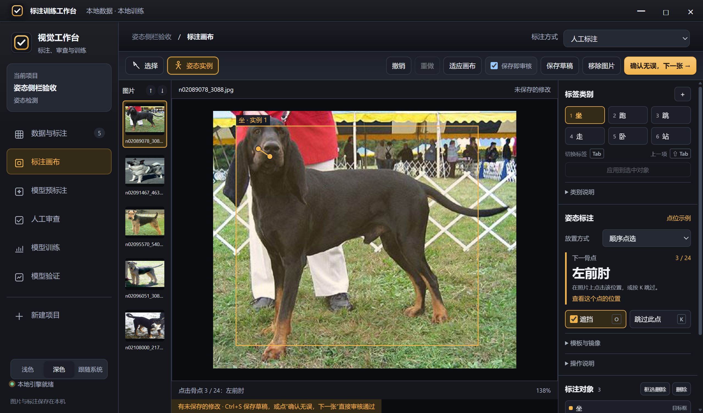

# 标注侧栏布局调整

目标：在画布旁完成类别选择、当前骨点定位、遮挡和跳过；让模板方向、镜像和长说明按需展开。保留原有画布与功能、深浅主题及快捷键。

配色沿用现有工作台：背景 #0f1116、侧栏 #15171d、操作面 #1c1f27、边线 #333944、当前状态 #f1b34c、正文 #eef1f6。浅色模式继续使用现有对应变量。字体沿用 Segoe UI / Microsoft YaHei UI：标题 13px、正文 12px、辅助和键帽 11px。

布局为左对齐的工作台检查栏，以 4px 间距为基础。类别较少时用规则三列按钮，隐藏重复下拉框；类别较多时使用下拉框。当前骨点单独显示名称和编号，遮挡/未知并列。镜像与模板方向放入折叠区；点位照片入口放在姿态标题旁。

草图：

```text
标签类别                  ＋
[1 坐]  [2 跑]  [3 跳]
[4 走]  [5 卧]  [6 站]
       应用到选中对象

姿态标注             点位示例
放置方式       [顺序点选 ▾]
下一骨点                 4/24
左后爪
[☑ 遮挡  O] [跳过此点  K]
▸ 模板与镜像

标注对象              删除
[对象与点位列表]
▸ 框选与删除说明
▸ AI 建议
```

评审：此处是持续操作的标注工具，不需要额外卡片或颜色体系。突出当前骨点，其余依靠对齐、紧凑行高和必要分隔；同一快捷键不再在多段文字里重复。常用操作不依赖展开区，低频操作保留可发现的入口。

验收：六类别三列对齐；当前点与所选点显示正确；遮挡、未知、撤销与示例入口保持可用；展开后镜像与模板设置可操作；深浅色、1050×700 与正常窗口下不横向溢出，常用姿态操作无需长距离滚动。


## 实现与验收

已落实布局、Tab标签切换、当前点照片定位与按项目记忆设置。大字显示下一骨点名称，编号单独右对齐；O遮挡和K跳过并排，模板镜像与长说明折叠。六类别为三列规则按钮。

22项Windows Electron实际鼠标键盘检查通过，含猫狗Tab循环、Shift+Tab反向、不中断骨架、当前肘部一键照片定位、跨图与刷新后恢复设置、模板微调后的下一张自动画图，以及深浅色和1050×700小窗口。JavaScript的85项边界交互、28项姿态/遮挡/快捷键回归、2项照片资源一致性及缩略图回归通过；语法检查通过。

原始记录：`.runtime/inspector-qa-accepted-20261018/report.json`。备份位于 `备份/20261018-sidebar-shortcuts-165626/`，8个原始文件的SHA256已经复核。未修改用户已有项目和标注；本次仍为源码更新，未重打包发布安装包，Ubuntu实际界面未验收。




