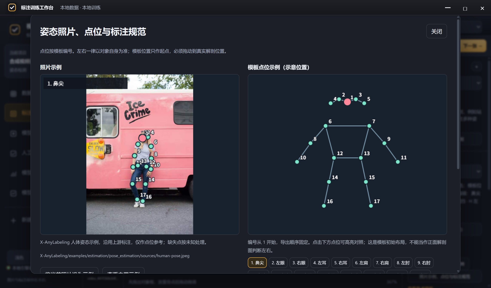
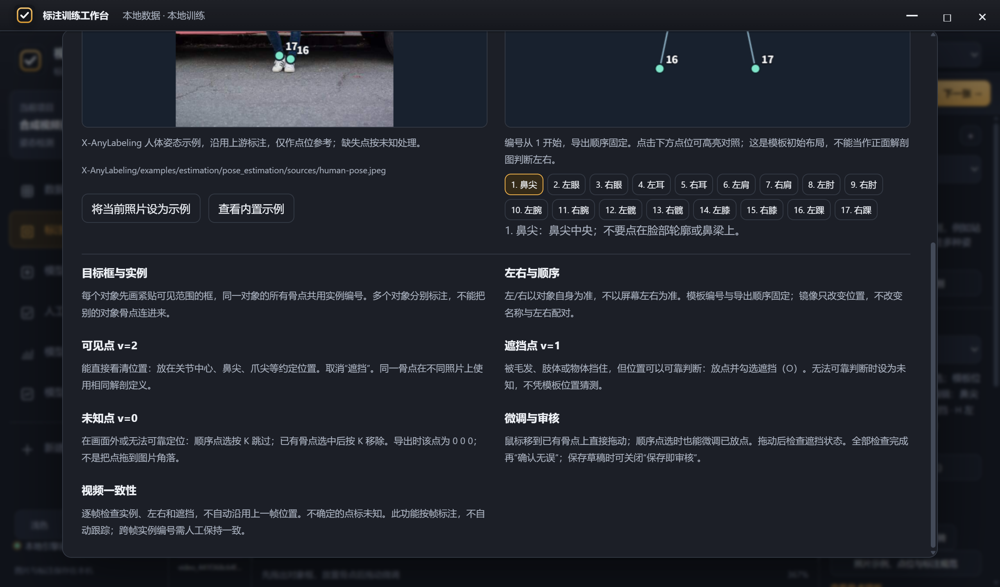
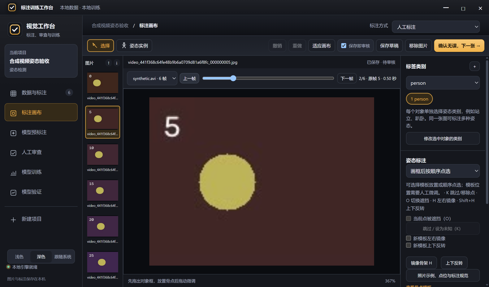
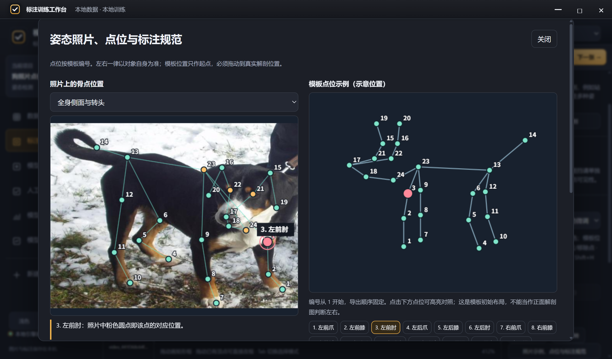

# 视频与姿态功能验收（2026-10-18）

本次修改已应用到本地源码；现有 0.4.1 安装包未重新构建。原文件备份位于 `备份/20261018-video-pose-152911/`，原始清单 9 个文件的 SHA256 已复核。

## 验证结果

- JavaScript 语法检查通过。
- 85 项画布边界交互、13 项姿态状态回归和跨项目缩略图回归通过。
- Python `test_video.py` 与 `test_project.py` 合计 28 项通过；`test_desktop.py` 与 `test_release_regressions.py` 合计 23 项通过，总计 51 项。
- Windows 原生 Electron 实际鼠标、键盘验收 31 项通过，使用隔离合成视频与项目。未修改用户原有项目、照片、视频或标注。
- 另行查看了人体照片、狗参考照片、自定义点位、规范正文与深浅色截图。照片正确渲染，未发现水平溢出；规范弹窗及右侧检查区可滚动。当前屏幕验收为 1279×752 逻辑像素、2×显示缩放。

## 实际界面检查

- create pose project directly from video
- background import yielded 6 editable frames
- video timeline visible
- sequential pose starts at first point
- next point checkbox applies occlusion
- unfinished sequence saves as draft despite auto-approve toggle
- drag during placement moves existing point without adding one
- O edits selected point occlusion
- next point visibility does not inherit selected point
- K skips next point
- undo restores skip index
- redo restores skipped index
- all remaining points can be unknown
- canvas selection synchronizes checkbox
- H mirrors selected pose
- double mirror restores positions
- vertical flip is reversible
- saved keypoint occlusion and omissions round-trip
- builtin reference photograph and 17 point legend
- point legend highlights the point and explains anatomical placement
- project photo reference persists
- timeline switches frame after saving
- reopened video annotation retained
- D advances in video sequence
- template orientation applies both axes
- K removes one selected template point without deleting instance
- removed template point can undo
- invalid video reports decoder error
- dog guide uses actual keypoint count
- custom guide uses actual keypoint count
- no horizontal overflow

## 使用与边界

通过项目根目录的“ 双击启动.vbs ”重新启动，载入更新后的源码界面。

数据页可导入视频，新建项目也可以直接选择视频来源。导入的是采样照片，使用时间条逐帧标注，不自动跟踪。真实视频编码兼容性取决于 OpenCV 解码器，本次端到端测试使用 MJPEG AVI；损坏 MP4 错误路径已验证，不代表所有 MP4/MKV 编码均已验收。

姿态画布右侧可打开照片、点位与规范面板。人体提供上游已有照片与骨点；狗参考照片没有 24 点姿态真值；自定义模板可将当前标注照片保存为项目参考。

快捷键：K 跳过/设为未知，O 切换遮挡，H 左右镜像，Shift+H 上下反转。顺序点选未完成时只存草稿，不提前审核。

Ubuntu 桌面本次未做实际界面验收。已有已发布 EXE/DEB 不会因源码修改自动更新。

## 截图

## 其他任务遮挡选项补充验收

检测、分割、旋转框、姿态目标框及整图分类已添加遮挡属性。使用单独的遮挡元数据，不改变类别、几何或原有 difficult 属性；姿态点仍使用原有可见性规则。

新增 37 项 Windows Electron 实际鼠标键盘检查通过，覆盖五类任务的勾选、O 快捷键、保存、实际 JSON 重开、撤销，以及分类标签与骨点可见性隔离。新增 Python 保存/导出检查 5 项通过，确认对象遮挡标记不改变普通 YOLO 标签；JavaScript 共 20 项姿态与遮挡状态回归、85 项边界交互及缩略图回归通过。当前安装的 Ultralytics 坐标损失使用关键点可见性非零作为有效掩码，v=1 与 v=2 并非自动采用不同坐标权重。

原始结果：`.runtime/occlusion-qa-20261018/report.json`。本次使用隔离合成项目；尚未做 Ubuntu 实际界面验收，也未重新打包安装包。

## 照片实际点位对应补充验收

狗参考图已换成两张全身照片，照片上直接显示24个编号、骨架线和选中点的名称引线。点击编号与点击照片骨点可双向选择，切换照片保持选中点。照片上没有坐标时明确提示缺失，不套用模板位置。

数据来源：https://docs.ultralytics.com/datasets/pose/dog-pose/ 。图片和前20点取自官方压缩包，并保留图片SHA256、原始标签数组及成员路径；21–24在官方包没有有效原始坐标，使用单独标识的橙色人工教学定位，不作为原始真值。全部参考不自动进入用户训练数据。

Windows Electron 新增34项实际鼠标键盘检查通过，含左前肘照片像素坐标核验、24点逐个高亮、切换全身照片、照片反向选择、人体肘部与自定义缺失点提示；另外2项资源一致性检查核验照片摘要与原始坐标未变。

原始验收记录：`.runtime/pose-photo-qa-20261018/report.json`。

